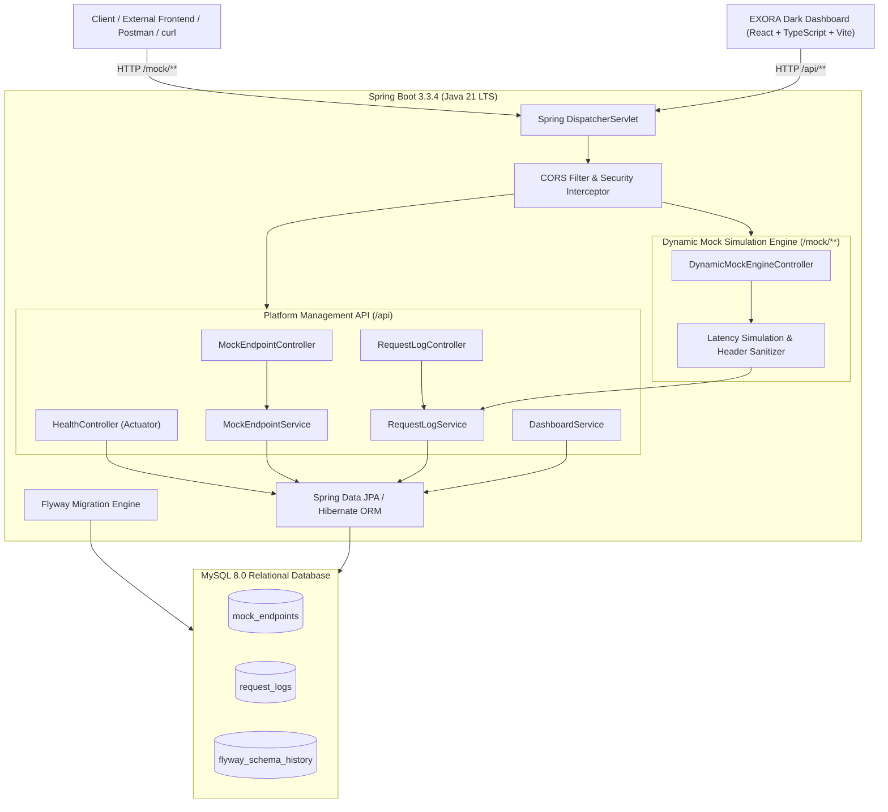

# EXORA: A Java-Based API Simulation and Testing Platform

> **Build. Simulate. Test.**

EXORA is a production-grade full-stack web application and developer utility designed to decouple frontend development from backend delivery. Developers can design, configure, simulate, and inspect mock HTTP endpoints that return custom status codes, headers, and payloads before production backend microservices are ready.

Developed as an **Advanced Programming Practice** project for second-year engineering students, EXORA showcases object-oriented software architecture, relational schema design with version-controlled migrations, dynamic servlet routing, input validation, automated test suites, and modern frontend design systems.

---

## Architecture Overview



---

## Core Capabilities

1. **Dynamic Servlet-Level Route Matching**: Intercepts arbitrary incoming HTTP methods (GET, POST, PUT, PATCH, DELETE) at `/mock/**` and dynamically evaluates paths against registered configurations.
2. **Realistic Network Simulation**: Configurable artificial latency up to 10,000 milliseconds for testing loading spinners, debounce behavior, race conditions, and client timeouts.
3. **Comprehensive Header and Payload Support**: Fully customizable HTTP response codes (100 to 599), custom response headers, and validated JSON payloads.
4. **Non-Destructive Endpoint Toggling**: Instant activation or deactivation of endpoints without data deletion. Inactive endpoints automatically return HTTP 403 Forbidden.
5. **Auditable Request Inspection & Sensitive Data Redaction**: Real-time logging of caller IP, method, exact path, query strings, headers, request payload, response status, and duration in milliseconds. Headers containing credentials (`Authorization`, `Cookie`, `Set-Cookie`, `X-Api-Key`) are automatically redacted before database storage.
6. **Built-in Interactive API Tester**: Test configured endpoints or external endpoints directly from the browser UI with instant JSON formatting, response time measurements, and auto-generated cURL commands.
7. **Production Dark Developer UI**: Engineered with a calm, high-density developer aesthetic, custom inline SVG icons, strict contrast adherence, and zero external font dependencies.

---

## Technology Stack

### Backend
- **Language**: Java 21 LTS
- **Framework**: Spring Boot 3.3.4
- **Persistence**: Spring Data JPA, Hibernate ORM 6.5
- **Database Driver**: MySQL Connector/J 8.3.0
- **Database Migrations**: Flyway Core 10.11 + Flyway MySQL
- **Validation**: Jakarta Bean Validation (`hibernate-validator`)
- **Monitoring**: Spring Boot Actuator
- **Testing**: JUnit 5, Mockito, Spring Test (MockMvc), H2 Database (in-memory testing)

### Frontend
- **Framework**: React 19
- **Language**: TypeScript 5.8 (with verbatim module syntax)
- **Tooling**: Vite 6 / Vite 8
- **Styling**: Tailwind CSS 3.4
- **Routing**: React Router 7
- **Testing**: Vitest 3, React Testing Library, jsdom
- **Icons**: Custom inline SVG icon system (zero third-party icon bundle bloat)

### Database & Infrastructure
- **RDBMS**: MySQL 8.0 (InnoDB engine, utf8mb4 character set, utf8mb4_unicode_ci collation)
- **Containerization**: Multi-stage Dockerfiles and Docker Compose orchestration
- **Web Server & Reverse Proxy**: Nginx Alpine

---

## Project Directory Structure

```text
EXORA/
|-- backend/                           # Java 21 Spring Boot Backend
|   |-- src/
|   |   |-- main/
|   |   |   |-- java/com/exora/
|   |   |   |   |-- config/            # WebConfig, CorsConfig
|   |   |   |   |-- controller/        # Management REST APIs
|   |   |   |   |-- dto/               # Strongly-typed request/response models
|   |   |   |   |-- entity/            # JPA entities (MockEndpoint, RequestLog)
|   |   |   |   |-- exception/         # GlobalExceptionHandler, Custom exceptions
|   |   |   |   |-- mock/              # Dynamic Mock Simulation Engine
|   |   |   |   |-- repository/        # Spring Data JPA repositories
|   |   |   |   `-- service/           # Endpoint, RequestLog, and Dashboard services
|   |   |   `-- resources/
|   |   |       |-- db/migration/      # Flyway SQL migrations (V1, V2)
|   |   |       `-- application.properties
|   |   `-- test/                      # JUnit 5 & Mockito test suites
|   |-- Dockerfile                     # Multi-stage Java 21 runtime image
|   `-- pom.xml                        # Maven configuration
|-- frontend/                          # React + TypeScript Frontend
|   |-- src/
|   |   |-- components/                # Reusable UI controls (JsonEditor, Badges)
|   |   |   `-- icons/                 # Custom SVG icons
|   |   |-- layouts/                   # AppShell navigation layout
|   |   |-- pages/                     # Overview, Endpoints, Requests, Tester, Settings
|   |   |-- services/                  # Backend REST API client layer
|   |   |-- test/                      # Vitest component test suites
|   |   `-- types/                     # TypeScript interface definitions
|   |-- Dockerfile                     # Multi-stage Node/Nginx production image
|   |-- nginx.conf                     # Production reverse proxy and SPA routing
|   |-- package.json
|   `-- vite.config.ts                 # Vite bundler configuration
|-- database/
|   `-- init.sql                       # MySQL user and database bootstrap
|-- docs/
|   |-- ARCHITECTURE.md                # System design & component interaction
|   |-- API_DOCUMENTATION.md           # Comprehensive REST endpoint specification
|   |-- DATABASE_SCHEMA.md             # Entity relationships, indexes, constraints
|   `-- TESTING.md                     # Verification reports & test execution
|-- docker-compose.yml                 # Full-stack container orchestration
|-- .env.example                       # Environment template
`-- README.md                          # Platform documentation
```

---

## Quickstart Guide

### Option 1: Running with Docker Compose (Recommended)

1. Clone or navigate to the EXORA root directory:
   ```bash
   cd EXORA
   ```

2. Start all containers (MySQL 8.0, Spring Boot Backend, Nginx Frontend):
   ```bash
   docker compose up -d --build
   ```

3. Access the services:
   - Frontend Dashboard: `http://localhost`
   - Backend REST API: `http://localhost:8080/api`
   - Health Status: `http://localhost:8080/api/health`
   - Mock Engine Base: `http://localhost:8080/mock`

---

### Option 2: Running Locally without Docker

#### Prerequisites
- Java 21 JDK (Microsoft OpenJDK, Eclipse Temurin, or Oracle JDK 21)
- Apache Maven 3.9+
- Node.js 20+ and npm
- MySQL 8.0 running on localhost

#### 1. Setup MySQL Database
Execute `database/init.sql` against your MySQL instance:
```bash
mysql -u root -p < database/init.sql
```
This provisions database `exora_db` with user `exora_user` and password `exora_secure_pass`.

#### 2. Start Backend
```bash
cd backend
mvn clean package -DskipTests
java -DDB_PORT=3306 -DDB_HOST=127.0.0.1 -DDB_NAME=exora_db -DDB_USERNAME=exora_user -DDB_PASSWORD=exora_secure_pass -jar target/exora-backend-1.0.0.jar
```
Flyway will automatically execute and apply schema versions `V1` and `V2`.

#### 3. Start Frontend
```bash
cd frontend
npm install
npm run dev
```
The developer dashboard will be active at `http://localhost:5173`.

---

## Verification and Example Usage

### 1. Create a Configured Mock Endpoint
```bash
curl -X POST http://localhost:8080/api/mock-endpoints \
  -H "Content-Type: application/json" \
  -d '{
    "name": "Get Products Catalog",
    "description": "Returns electronics product list",
    "httpMethod": "GET",
    "path": "/api/products",
    "statusCode": 200,
    "delayMs": 0,
    "responseHeaders": "{\"X-Custom-Header\":\"ExoraMock\"}",
    "responseBody": "{\"products\":[{\"id\":1,\"name\":\"Laptop\",\"price\":55000},{\"id\":2,\"name\":\"Headphones\",\"price\":2000}]}",
    "enabled": true
  }'
```

### 2. Invoke the Mock Endpoint
Send an HTTP GET request to the dynamic mock URL:
```bash
curl -i http://localhost:8080/mock/api/products
```

**Response Output:**
```http
HTTP/1.1 200 OK
Content-Type: application/json;charset=UTF-8
X-Custom-Header: ExoraMock
Content-Length: 95

{"products":[{"id":1,"name":"Laptop","price":55000},{"id":2,"name":"Headphones","price":2000}]}
```

### 3. Inspect Audited Request Logs
Retrieve persisted request log history:
```bash
curl -s http://localhost:8080/api/requests | jq .
```

---

## Automated Test Suites

### Backend Unit & Integration Tests
Run JUnit 5 and Mockito tests:
```bash
cd backend
mvn test
```
- **MockEndpointServiceTest**: Service-level business logic, duplicate path validations, toggle operations.
- **DynamicMockEngineControllerTest**: Mock URL pattern matching, header propagation, delay handling.
- **MockEndpointControllerTest**: MockMvc REST controller input validation.

### Frontend Unit & Component Tests
Run Vitest component tests:
```bash
cd frontend
npm run test
```
- **MethodBadge.test.tsx**: Correct styling and contrast for all HTTP verbs.
- **StatusBadge.test.tsx**: Correct visual category grouping for 2xx, 3xx, 4xx, and 5xx status codes.
- **JsonEditor.test.tsx**: Syntax highlighting, formatting, and validation error detection.

---

## Academic Information

- **Course**: Advanced Programming Practice
- **Curriculum Level**: Second-Year Engineering Undergraduate
- **Subject Areas**: Object-Oriented Programming, Enterprise Web Architectures, Database Systems, API Design, Automated Testing, Cloud Containerization
- **Status**: Production-Quality Implementation
