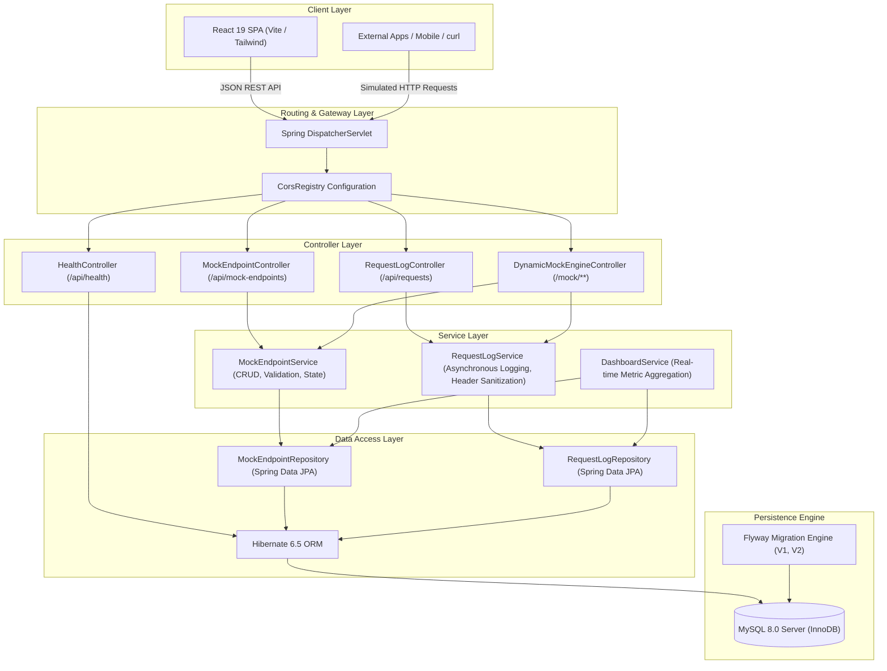
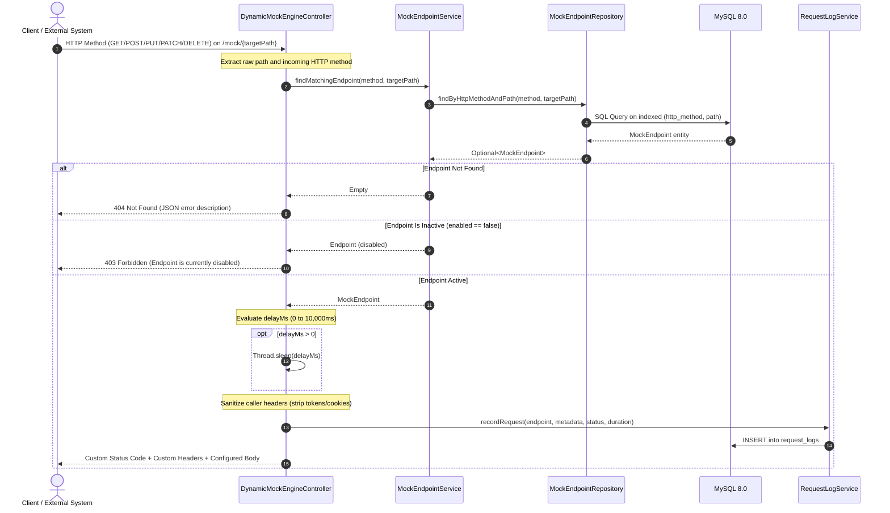

# EXORA System Architecture

## 1. Architectural Philosophy

EXORA follows a clean layered enterprise architecture implemented with Java 21 LTS and Spring Boot 3.3.4 on the backend, paired with a React 19 and TypeScript frontend. The system separates administrative API management from runtime mock request simulation.

---

## 2. Dynamic Mock Engine Lifecycle

The dynamic mock engine is implemented inside `DynamicMockEngineController` mapped to `/mock/**`. When a client sends a request to any path prefixed with `/mock/`, the engine executes the following pipeline:

---

## 3. Key Design Decisions

### 3.1 Non-Destructive Endpoint Toggling
Rather than requiring developers to delete and recreate endpoints to simulate outages, endpoints include an `enabled` boolean flag. Inactive endpoints immediately return HTTP 403 Forbidden, allowing developers to test frontend resilience to server errors without losing configuration.

### 3.2 Sensitive Header Sanitization
When external clients invoke endpoints with authentication headers, storing sensitive credentials in plain text presents a security hazard. EXORA implements a sanitization routine before persisting metadata into `request_logs`. Headers matching `Authorization`, `Cookie`, `Set-Cookie`, `X-Api-Key`, or `Proxy-Authorization` are replaced with `[REDACTED]`.

### 3.3 Dynamic Schema Management with Flyway
Database schemas are version-controlled using Flyway migrations located in `backend/src/main/resources/db/migration/`:
- `V1__create_mock_endpoints_table.sql`: Primary endpoint configuration table, composite unique constraint on `(http_method, path)`.
- `V2__create_request_logs_table.sql`: Request inspection audit log, foreign key relationship referencing `mock_endpoints(id)` with `ON DELETE SET NULL`.

### 3.4 Decoupled Frontend Design System
The frontend avoids heavy third-party UI component libraries in favor of Tailwind CSS utility classes and clean inline SVG icons. This ensures minimal bundle size (348 kB JS gzip-ready), sub-second page loads, and consistent dark-mode styling aligned with professional developer tools.
