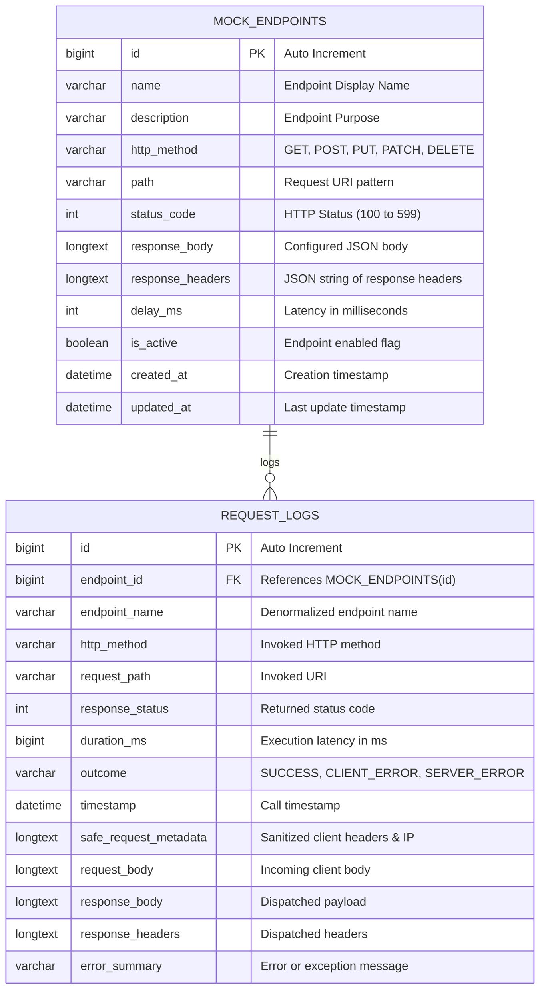

# EXORA Relational Database Schema Specification

This document details the relational database schema implemented in MySQL 8.0 for EXORA, managed using Flyway migrations.

---

## 1. Entity-Relationship Diagram

---

## 2. Table Definitions

### 2.1 Table: `mock_endpoints`
Stores developer-configured mock API definitions.

| Column | Type | Nullable | Default | Description |
|---|---|---|---|---|
| `id` | `BIGINT` | `NO` | `AUTO_INCREMENT` | Primary Key. Unique identifier. |
| `name` | `VARCHAR(150)` | `NO` | - | Descriptive name for the mock endpoint. |
| `description` | `VARCHAR(500)` | `YES` | `NULL` | Optional documentation notes. |
| `http_method` | `VARCHAR(10)` | `NO` | - | HTTP method: `GET`, `POST`, `PUT`, `PATCH`, `DELETE`. |
| `path` | `VARCHAR(255)` | `NO` | - | Normalized route path, prefixed with `/`. |
| `status_code` | `INT` | `NO` | `200` | HTTP response code (100-599). |
| `response_body` | `LONGTEXT` | `YES` | `NULL` | Static response payload returned to clients. |
| `response_headers` | `LONGTEXT` | `YES` | `NULL` | JSON string of custom response headers. |
| `delay_ms` | `INT` | `NO` | `0` | Artificial network delay in milliseconds (0-10000). |
| `is_active` | `BOOLEAN` | `NO` | `TRUE` | Enable/disable toggle flag. |
| `created_at` | `DATETIME(6)` | `NO` | `CURRENT_TIMESTAMP(6)` | Record creation timestamp. |
| `updated_at` | `DATETIME(6)` | `NO` | `CURRENT_TIMESTAMP(6)` | Record last update timestamp. |

#### Constraints & Indexes
- **Primary Key**: `PRIMARY KEY (id)`
- **Unique Constraint**: `CONSTRAINT uq_method_path UNIQUE (http_method, path)`
- **Index**: `CREATE INDEX idx_mock_endpoints_active ON mock_endpoints (is_active)`

---

### 2.2 Table: `request_logs`
Stores execution traces and performance metrics for all calls routed through `/mock/**`.

| Column | Type | Nullable | Default | Description |
|---|---|---|---|---|
| `id` | `BIGINT` | `NO` | `AUTO_INCREMENT` | Primary Key. |
| `endpoint_id` | `BIGINT` | `YES` | `NULL` | Foreign key referencing `mock_endpoints(id)`. |
| `endpoint_name` | `VARCHAR(150)` | `YES` | `NULL` | Name captured at call time for historical reporting. |
| `http_method` | `VARCHAR(10)` | `NO` | - | HTTP method invoked by caller. |
| `request_path` | `VARCHAR(255)` | `NO` | - | Invoked path requested by caller. |
| `response_status` | `INT` | `NO` | - | HTTP status code returned to caller. |
| `duration_ms` | `BIGINT` | `NO` | `0` | Total request latency including simulated delay. |
| `outcome` | `VARCHAR(30)` | `NO` | - | Outcome classification: `SUCCESS`, `DISABLED`, `NOT_FOUND`, `ERROR`. |
| `timestamp` | `DATETIME(6)` | `NO` | `CURRENT_TIMESTAMP(6)` | Invocation timestamp. |
| `safe_request_metadata`| `LONGTEXT` | `YES` | `NULL` | JSON payload of sanitized headers, IP, and query params. |
| `request_body` | `LONGTEXT` | `YES` | `NULL` | Raw request body sent by client. |
| `response_body` | `LONGTEXT` | `YES` | `NULL` | Payload dispatched to client. |
| `response_headers` | `LONGTEXT` | `YES` | `NULL` | Custom headers dispatched to client. |
| `error_summary` | `VARCHAR(500)` | `YES` | `NULL` | Brief failure description if status >= 400. |

#### Constraints & Indexes
- **Primary Key**: `PRIMARY KEY (id)`
- **Foreign Key**: `CONSTRAINT fk_request_logs_endpoint FOREIGN KEY (endpoint_id) REFERENCES mock_endpoints(id) ON DELETE SET NULL`
- **Index**: `CREATE INDEX idx_request_logs_timestamp ON request_logs (timestamp DESC)`
- **Index**: `CREATE INDEX idx_request_logs_endpoint ON request_logs (endpoint_id)`
- **Index**: `CREATE INDEX idx_request_logs_status ON request_logs (response_status)`

---

## 3. Flyway Migration Version History

Migrations are executed automatically on Spring Boot application startup before the JPA `EntityManagerFactory` initializes:

1. **`V1__create_mock_endpoints_table.sql`**: Initial DDL creating the `mock_endpoints` table, primary key, and composite unique constraint.
2. **`V2__create_request_logs_table.sql`**: DDL creating `request_logs`, foreign key referencing `mock_endpoints(id)` with `ON DELETE SET NULL`, and lookup indexes.
