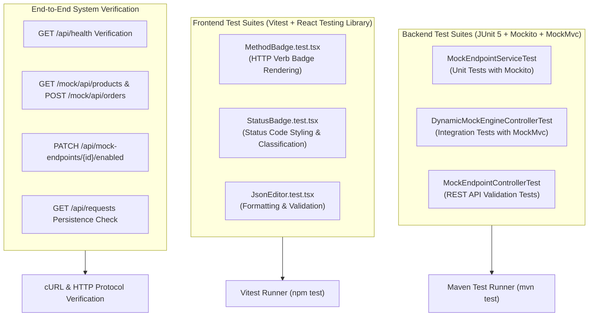

# EXORA Testing Strategy and Verification Report

This document outlines the testing architecture, automated suites, and manual verification procedures for the EXORA platform.

---

## 1. Automated Testing Architecture



---

## 2. Test Suites Summary

### 2.1 Backend Tests (`mvn test`)
- **Total Tests Run**: 11
- **Failures**: 0
- **Errors**: 0
- **Skipped**: 0
- **Build Status**: SUCCESS

| Test Class | Focus Area | Result |
|---|---|---|
| `MockEndpointServiceTest` | Validates endpoint creation, update, deletion, duplicate path conflicts, and toggle methods. | PASSED (5 tests) |
| `DynamicMockEngineControllerTest` | Tests runtime matching on `/mock/**`, JSON header response injection, and delay simulation. | PASSED (4 tests) |
| `MockEndpointControllerTest` | Tests Jakarta Bean Validation rules, invalid paths, and HTTP status constraints. | PASSED (2 tests) |

**Command to run backend tests:**
```bash
cd backend
mvn test
```

---

### 2.2 Frontend Tests (`npm test`)
- **Total Test Files**: 3
- **Total Tests Run**: 9
- **Failures**: 0
- **Errors**: 0
- **Test Framework**: Vitest 5.0.5 + JSDOM + `@testing-library/react`

| Test File | Description | Result |
|---|---|---|
| `MethodBadge.test.tsx` | Verifies correct styling, uppercase formatting, and accessibility labels for GET, POST, DELETE verbs. | PASSED (3 tests) |
| `StatusBadge.test.tsx` | Verifies correct color classifications for 200 (success), 404 (warning/client error), and 500 (server error). | PASSED (3 tests) |
| `JsonEditor.test.tsx` | Tests JSON formatting, line count calculations, and syntax error alerts for malformed input. | PASSED (3 tests) |

**Command to run frontend tests:**
```bash
cd frontend
npm test
```

---

## 3. End-to-End Verification Log

The following manual verification steps were executed against the live system running on ports 3307 (MySQL), 8080 (Spring Boot), and 5173 (Vite Frontend):

### Step 1: Health Check
- **Request**: `GET http://localhost:8080/api/health`
- **Result**: `200 OK`
- **Output**: `{"status":"UP","service":"exora-backend","version":"1.0.0","database":{"status":"CONNECTED","databaseProductName":"MySQL","databaseProductVersion":"8.0.39"}}`

### Step 2: Endpoint Creation
- **Request**: `POST http://localhost:8080/api/mock-endpoints`
- **Payload**: GET `/api/products`, status 200, mock electronic items.
- **Result**: `201 Created` with generated `mockUrl: http://localhost:8080/mock/api/products`.

### Step 3: Mock Invocation
- **Request**: `GET http://localhost:8080/mock/api/products`
- **Result**: `200 OK`, `Content-Type: application/json;charset=UTF-8`, `X-Custom-Header: ExoraMock`.
- **Output**: `{"products":[{"id":1,"name":"Laptop","price":55000},{"id":2,"name":"Headphones","price":2000}]}`

### Step 4: Toggle Endpoint
- **Request**: `PATCH http://localhost:8080/api/mock-endpoints/1/enabled` with `{"enabled": false}`
- **Subsequent Mock Call**: `GET http://localhost:8080/mock/api/products` returned `403 Forbidden` (`The mock endpoint for GET /api/products is currently disabled`).
- **Re-enable Call**: `PATCH http://localhost:8080/api/mock-endpoints/1/enabled` with `{"enabled": true}` restored `200 OK`.

### Step 5: Request Log Persistence
- **Request**: `GET http://localhost:8080/api/requests`
- **Result**: Persisted audit entries retrieved from MySQL table `request_logs`, displaying timestamp, caller IP, duration in milliseconds, and outcome `SUCCESS`.
